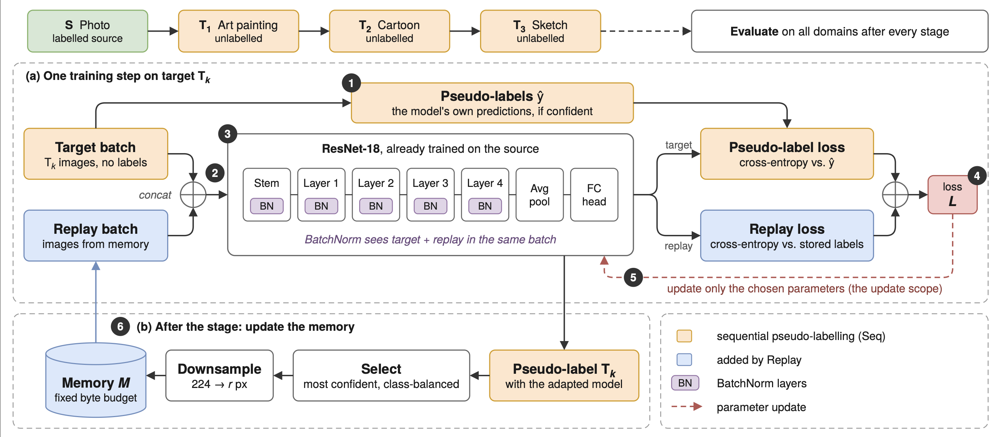
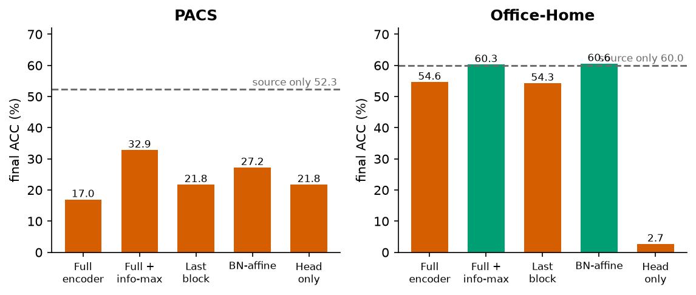
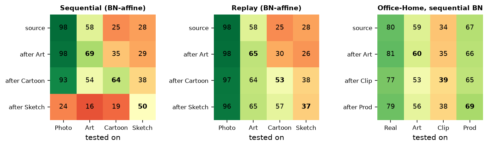
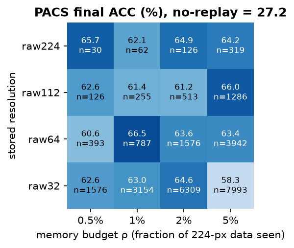
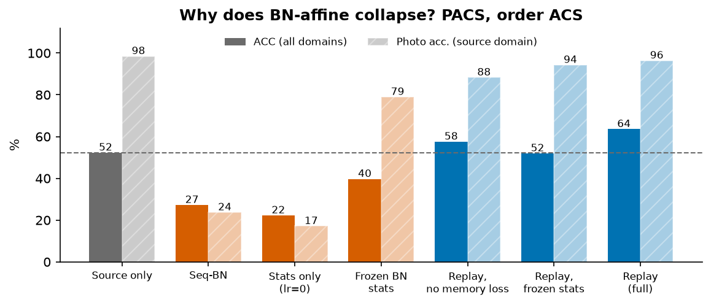

# Adapting Without Forgetting

Continual unsupervised domain adaptation with a small, byte-budgeted replay memory. A ResNet-18 is trained on a labelled source domain and then adapted, **without labels**, to three target domains in sequence. We study when sequential pseudo-label self-training collapses, whether a tiny replay memory fixes it, and why.

- **Datasets:** PACS (Photo → Art → Cartoon → Sketch, 7 classes) and Office-Home (Real World → Art → Clipart → Product, 65 classes).
- **Study size:** 36 adaptation runs + 2 source models, one seed (0), about 1 GPU-hour in total.
- **Target labels are never used for training**, only for evaluation and for logging pseudo-label accuracy.

## Architecture



1. **Stage 0:** fine-tune an ImageNet ResNet-18 on the labelled source domain. All runs start from this same checkpoint.
2. **Stages 1–3:** for each unlabelled target domain, in order:
   - pseudo-label the target images with the current model, in eval mode, recomputed every epoch, and keep those with confidence ≥ τ (0.8 on PACS, 0.6 on Office-Home);
   - train on the target batch concatenated with a replay batch from the memory;
   - only the chosen *scope* of parameters is updated (`full`, `lastblock`, `bn` = BatchNorm affine, `head`);
   - at the end of the stage, add the highest-confidence pseudo-labelled images to the memory.
3. **Replay memory:** byte budget B = ρ · (images seen) · 3·224² bytes, split equally across domains and class-balanced. Images are stored at r×r pixels (224/112/64/32), so a 64 px memory holds about 12× more images than a 224 px one for the same bytes. Source images keep their true labels; target images keep their pseudo-labels.
4. **Evaluation:** after every stage, test on every domain's held-out split → an accuracy matrix A[k][j]. From it: ACC (mean of the final row), forgetting, new-domain accuracy.

### Methods and scopes

| Name | Meaning |
|---|---|
| `fixed` | source model, no adaptation (baseline) |
| `seq` | sequential pseudo-label adaptation, no memory |
| `replay` | `seq` plus the replay memory |
| scope `full` / `lastblock` / `bn` / `head` | which parameters receive gradient updates (SGD, momentum 0.9; lr 1e-4 / 1e-4 / 1e-3 / 1e-3) |
| `--im_weight > 0` | adds a SHOT-style information-maximisation loss (used with `full`) |

Defaults: 5 epochs per stage, batch 64, replay weight 1.0, ρ = 2%, 64 px, memory = source + past targets.

### Experiments (`src/make_jobs.py`)

| Group | Question | Runs |
|---|---|---|
| E1 scope | which update scopes collapse? (full / last block / BN-affine / head, plus full + info-max) | 10 |
| E2 main | fixed vs seq vs replay (64 px, ρ = 2%), head and BN-affine | 10 |
| E3 memory | resolution {224, 112, 64, 32} × budget ρ {0.5, 1, 2, 5}% (PACS, BN-affine) | 16 |
| E4 source-free | memory with source + past targets vs past targets only (PACS) | 3 |
| E4 order | three domain orders × {seq, replay} (PACS) | 6 |

(Groups overlap, so 36 unique runs.) Extra diagnostics for the BatchNorm analysis are in `src/diag_bn.py`.

## Repository layout

```
env.sh                  paths, Python env and SLURM settings (edit this)
requirements.txt
smoke_test.sh           end-to-end check on synthetic data
src/common.py           dataset definitions, defaults, run ids
src/data.py             images -> uint8 tensor cache; GPU augmentation
src/models.py           ResNet-18 + update scopes
src/memory.py           byte-budgeted, class-balanced replay memory
src/metrics.py          ACC, forgetting, new-domain accuracy
src/train_source.py     one source checkpoint per (dataset, seed)
src/adapt.py            one continual adaptation run -> results/runs/<id>.json
src/make_jobs.py        defines the experiments, writes jobs/*.txt + manifest.json
src/analyze.py          tables (md + LaTeX) and figures from results/
src/download_data.py    downloads PACS and Office-Home
src/diag_bn.py          BatchNorm diagnostics (frozen / stats-only)
src/qualitative.py      saves per-image test predictions of a final model
src/make_fake_data.py   synthetic data for the smoke test
slurm/                  prepare / array / analyze scripts and submit_all.sh
```

## How to run

Needs Python with PyTorch, a CUDA GPU (about 1 GPU-hour total) and ~6 GB of disk for data and caches.

```bash
# 1. Environment
pip install -r requirements.txt datasets        # use the torch build matching your CUDA
# edit env.sh (paths, conda env via CONDA_ENV, SLURM partition) then:
source env.sh

# 2. Data (needs internet). Layout: <root>/<domain>/<class>/<image>
python src/download_data.py --dataset pacs       --out "$DATA_ROOT_PACS"
python src/download_data.py --dataset officehome --out "$DATA_ROOT_OFFICEHOME"

# 3. Pre-download ImageNet weights (compute nodes may be offline)
python -c "import torchvision as tv; tv.models.resnet18(weights='IMAGENET1K_V1')"

# 4. Optional: check the plumbing on synthetic data (~5-15 min on CPU)
bash smoke_test.sh                               # ends with "SMOKE TEST PASSED"

# 5. Build the caches (CPU) and the job lists
python src/data.py --dataset pacs
python src/data.py --dataset officehome          # or: sbatch slurm/prepare.sbatch
python src/make_jobs.py

# 6. Train the source models, then run all 36 adaptation runs
#    On SLURM (source -> adapt -> analyze, re-runnable, only submits what is missing):
bash slurm/submit_all.sh
#    Without SLURM, run the lines yourself:
while read -r l; do python $l; done < jobs/source.txt
while read -r l; do python $l; done < jobs/adapt.txt

# 7. Tables and figures
python src/analyze.py --manifest jobs/manifest.json --out analysis
```

A run counts only if its JSON in `results/runs/` has `"finished": true`; `analysis/run_status.csv` lists any that are missing. A single run can be launched directly, for example:

```bash
python src/adapt.py --dataset pacs --method replay --scope bn --res 64 --rho 0.02 --order ACS
```

Optional BatchNorm diagnostics (write into a separate results folder):

```bash
export RESULTS_DIR=$PWD/results_diag
BN_DIAG=frozen_stats python src/diag_bn.py --dataset pacs --method seq    --scope bn
BN_DIAG=stats_only   python src/diag_bn.py --dataset pacs --method seq    --scope bn --lr 0
BN_DIAG=frozen_stats python src/diag_bn.py --dataset pacs --method replay --scope bn
python src/adapt.py --dataset pacs --method replay --scope bn --replay_weight 0
```

On SLURM, partition, QoS and GPU type are set in `env.sh`; `PARTITIONS="l40 a40"` can be passed to `submit_all.sh` to spread the runs over several partitions.

## Results

All numbers are percentages, one seed. **ACC** = mean accuracy over all domains (including the source) after the last stage. **Forgetting** = best earlier accuracy minus final accuracy (negative = improved). **New-domain** = mean accuracy on each domain right after adapting to it.

### Replay vs sequential (E2)

| Dataset | Scope | Method | ACC | Forgetting | New-domain | Source acc |
|---|---|---|---|---|---|---|
| PACS | – | Fixed source | 52.3 | 0.0 | 37.0 | 98.5 |
| PACS | Head | Sequential | 21.8 | 31.4 | 27.6 | 28.2 |
| PACS | Head | Replay | 49.0 | −0.4 | 30.6 | 98.2 |
| PACS | BN-affine | Sequential | 27.2 | 57.6 | 61.1 | 23.7 |
| PACS | BN-affine | **Replay** | **63.6** | −0.5 | 51.4 | 96.4 |
| Office-Home | – | Fixed source | 60.0 | 0.0 | 53.4 | 80.1 |
| Office-Home | Head | Sequential | 2.7 | 44.7 | 21.6 | 4.1 |
| Office-Home | Head | Replay | 8.9 | 38.4 | 23.5 | 15.6 |
| Office-Home | BN-affine | Sequential | 60.6 | 2.2 | 56.1 | 78.8 |
| Office-Home | BN-affine | Replay | 59.9 | 1.4 | 54.3 | 79.5 |

- On PACS, sequential adaptation falls **below the source-only baseline** and forgets the source (Photo 98.5 → 23.7). A small replay memory fixes this (27.2 → 63.6, +11.3 over source-only) at a cost of about 10 points of new-domain accuracy.
- On Office-Home there is little forgetting to repair: BN-affine is already at the baseline and replay changes nothing (−0.7). Head-only collapses either way.

### Which update scope collapses? (E1, sequential, ACC)



On PACS every scope ends below the source-only 52.3 (full 17.0, full + info-max 32.9, last block 21.8, BN-affine 27.2, head 21.8). On Office-Home only head-only collapses (2.7); the others stay at 54–61. Full-encoder and head-only fail by pseudo-label self-reinforcement (pseudo-label accuracy falls and one class takes over). BN-affine on PACS fails differently, with pseudo-labels still about 96% correct (below).

### Accuracy matrices (BN-affine, PACS)



Rows are time, columns are test domains. Sequential adaptation is fine through Art and Cartoon, then every domain collapses when it adapts to Sketch; replay keeps Photo at 96.

### Memory format and budget (E3, PACS, BN-affine, final ACC)

| Format | ρ = 0.5% | ρ = 1% | ρ = 2% | ρ = 5% |
|---|---|---|---|---|
| raw224 | 65.7 (n=30) | 62.1 (62) | 64.9 (126) | 64.2 (319) |
| raw112 | 62.6 (126) | 61.4 (255) | 61.2 (513) | 66.0 (1286) |
| raw64 | 60.6 (393) | 66.5 (787) | 63.6 (1576) | 63.4 (3942) |
| raw32 | 62.6 (1576) | 63.0 (3154) | 64.6 (6309) | 58.3 (7993) |
| no replay (seq) | 27.2 | 27.2 | 27.2 | 27.2 |

(n = images stored.) Any memory lifts PACS from 27 to about 58–67, but resolution and budget show **no consistent trend**; with one seed, differences of a few points are within noise. Even 30 full-size images work.



### Ablations (PACS, BN-affine)

| Study | Setting | ACC | Forgetting | Source acc |
|---|---|---|---|---|
| Memory content | source + past targets | 63.6 | −0.5 | 96.4 |
| Memory content | past targets only (source-free) | 63.0 | 0.0 | 97.0 |
| Domain order | Art → Cartoon → Sketch (replay / seq) | 63.6 / 27.2 | −0.5 / 57.6 | 96.4 / 23.7 |
| Domain order | Cartoon → Art → Sketch (replay / seq) | 65.2 / 26.5 | −2.6 / 57.6 | 95.8 / 24.0 |
| Domain order | Sketch → Cartoon → Art (replay / seq) | 48.8 / 56.6 | 6.5 / 15.0 | 91.3 / 96.7 |

Source images are not needed in the memory. Domain order matters, and when Sketch comes first sequential adaptation beats replay.

### Why does replay work? (BatchNorm diagnostics, PACS, BN-affine)

| Variant | ACC | What it tests |
|---|---|---|
| Sequential (baseline) | 27.2 | |
| Sequential, BN statistics frozen | 39.7 | removes running-statistics drift |
| Sequential, only statistics update (lr = 0) | 22.3 | drift alone, no weight change |
| Replay with no loss on memory images (`--replay_weight 0`) | 57.6 | statistics mixing without rehearsal |
| Replay with frozen statistics | 52.0 | rehearsal without statistics mixing |
| Replay | 63.6 | |



The sequential model collapses even when only the BatchNorm running statistics change (22.3), so statistics drift towards the newest domain is enough to destroy it. Replay without the memory loss still reaches 57.6, so most of the gain comes from mixing old-domain images into the batch (balanced statistics). Replay with frozen statistics (52.0) is no better than the source-only baseline. The rehearsal loss adds the last ~6 points.

### Limitations

One seed (no confidence intervals), ResNet-18 only, two datasets, fixed hyper-parameters (not tuned), diagnostics on PACS BN-affine with one domain order only. Treat differences of a few points as noise.
